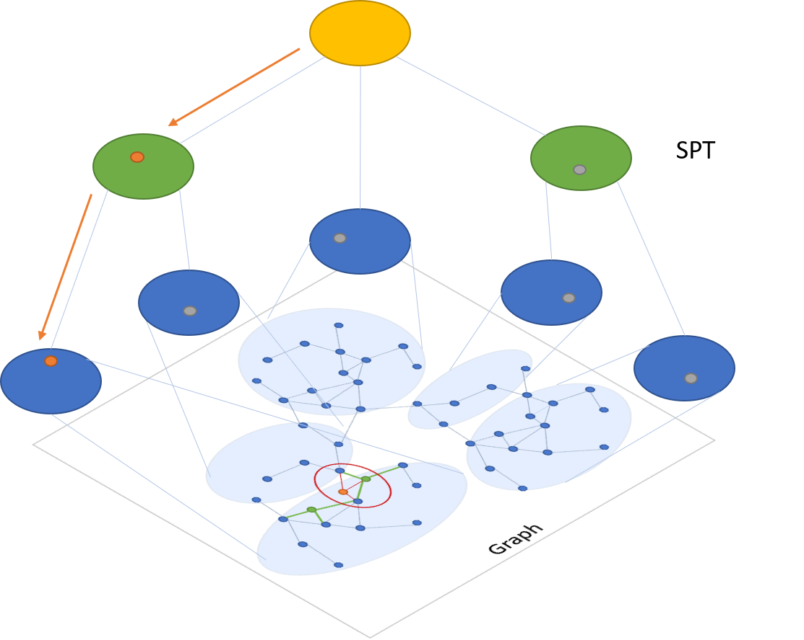

# SPTAG: vector search with trees and graphs

[](LICENSE)

SPTAG (Space Partition Tree And Graph) is a C++ library for approximate nearest
neighbor search, originally released by Microsoft Research and Microsoft Bing.
It supports L2 and cosine distance, with BKT (balanced k-means tree) and KDT
(kd-tree) indexes.

This development line also contains SPANN disk-based indexing, SPFresh
incremental updates, and experimental TiKV, RaBitQ, and distributed-build
integrations. Their presence does **not** imply that every feature combination
is production-ready or supported on every platform. See the
[support matrix](docs/SupportMatrix.md) before choosing a configuration.

The repository also hosts research associated with **SPIRE**,
[Scalable Distributed Vector Search via Accuracy Preserving Index Construction](https://arxiv.org/abs/2512.17264).
SPIRE studies scalable distributed vector search through partition-granularity
selection and accuracy-preserving recursive, multi-level index construction.
See the [distributed research workflow](evaluation/distributed/Readme.md).

<p align="center">
  
</p>

## Capabilities

| Area | Description | Documentation |
| --- | --- | --- |
| In-memory search | BKT/KDT graph construction, search, and index persistence | [Quick start](docs/QuickStart.md) |
| Disk-based search | SPANN head index and posting storage | [Usage reference](docs/GettingStart.md) |
| Incremental updates | SPFresh insertion, deletion, split, and reassign workflows | [Architecture](docs/Architecture.md) |
| Distributed posting storage | Experimental TiKV RawKV backend | [TiKV integration](docs/TiKV-Integration.md) |
| Quantization | Optional RaBitQ model training and encoded-vector search | [RaBitQ guide](docs/RaBitQ_Global_Quantizer.md) |
| Distributed construction research (SPIRE) | MPI-based partitioning and distributed build workflows | [Distributed research workflow](evaluation/distributed/Readme.md) |

## Build the baseline

The baseline uses TBB and disables Folly, SPDK, RocksDB, TiKV, GPU, and RaBitQ.
It needs no running service, special SSD, or downloaded dataset.

On Ubuntu 24.04 with GCC 13:

```bash
sudo apt-get update
sudo apt-get install -y build-essential cmake ninja-build git swig python3-dev \
  libboost-system-dev libboost-thread-dev libboost-serialization-dev \
  libboost-regex-dev libboost-filesystem-dev libboost-test-dev libtbb-dev libnuma-dev

git clone https://github.com/microsoft/SPTAG.git
cd SPTAG
git submodule update --init ThirdParty/zstd

cmake -S . -B build -G Ninja -DCMAKE_BUILD_TYPE=Release \
  -DFOLLY=OFF -DTBB=ON -DSPDK=OFF -DROCKSDB=OFF -DTIKV=OFF -DGPU=OFF -DRABITQ=OFF
cmake --build build --target indexbuilder indexsearcher SPTAGTest --parallel 2
```

Run the [small, self-checking example](docs/QuickStart.md), which builds, saves,
reloads, and queries an index without external data. Node.js 20 or later is
needed only for the example driver and documentation checks:

```bash
node Tools/quickstart.mjs Release
```

Full instructions: [Linux](docs/LinuxInstallation.md),
[Windows](docs/WindowsInstallation.md), and
[build options and dependencies](docs/BuildOptions.md).
On Linux, executables are written to the repository's `Release` directory,
not `build/Release`. Windows CMake builds use `build/Release`.

## Documentation

Start with the [documentation index](docs/README.md).
See [the changelog](CHANGELOG.md) for unreleased maintenance changes.

- **Users:** [quick start](docs/QuickStart.md), [parameters](docs/Parameters.md),
  [command-line and SPANN examples](docs/GettingStart.md).
- **Developers:** [architecture](docs/Architecture.md),
  [contribution and test instructions](CONTRIBUTING.md).
- **Experiments:** [benchmark methodology](BENCHMARK_GUIDE.md),
  [evaluation index](evaluation/README.md),
  [historical paper artifacts](Script_AE/README.md).
- **Compatibility:** [platform and feature status](docs/SupportMatrix.md),
  [RaBitQ implementation and compatibility](docs/development/RaBitQ.md).

The [Python tutorial](docs/Tutorial.ipynb) is an additional wrapper example,
not a prerequisite for the baseline C++ workflow.

## Validation

```bash
node --test Tools/check-docs.test.mjs
node Tools/check-docs.mjs
node Tools/quickstart.mjs Release
Release/SPTAGTest --run_test=CommonHelperTest:IniReaderTest:ConcurrentHashMapTest:AlgoTest/BKTTest:AlgoTest/KDTTest --log_level=test_suite
```

The [GitHub Actions workflow](.github/workflows/ci.yml) defines the baseline
Linux build and documentation checks. A workflow definition is not a claim
that a remote run has passed. See [CONTRIBUTING.md](CONTRIBUTING.md) for the
scope of these checks and optional-backend testing.

The existing `DedupCandidateTest` currently fails on deleted-then-live visibility
sequences. It is reported separately as a known, non-blocking CI diagnostic,
not counted as a passing baseline test. See [known limitations](docs/SupportMatrix.md).

## Research and citation

- [SPIRE: Scalable Distributed Vector Search via Accuracy Preserving Index Construction (arXiv, 2025)](https://arxiv.org/abs/2512.17264).
- [SPFresh: Incremental In-Place Update for Billion-Scale Vector Search (SOSP 2023)](https://dl.acm.org/doi/10.1145/3600006.3613166).
- [VBASE: Unifying Online Vector Similarity Search and Relational Queries via Relaxed Monotonicity (OSDI 2023)](https://www.usenix.org/system/files/osdi23-zhang-qianxi_1.pdf).
- [SPANN: Highly-efficient Billion-scale Approximate Nearest Neighbor Search (NeurIPS 2021)](https://proceedings.neurips.cc/paper_files/paper/2021/file/299dc35e747eb77177d9cea10a802da2-Paper.pdf).

Citation entries and earlier references are in [References](docs/References.md).
Experimental reports describe particular runs; they are not performance
guarantees for the current branch.

## Contributing and reporting issues

Read [CONTRIBUTING.md](CONTRIBUTING.md) before submitting changes. Report
reproducible bugs and feature requests through
[GitHub issues](https://github.com/microsoft/SPTAG/issues).
Report vulnerabilities privately as described in [SECURITY.md](SECURITY.md),
not through public issues.

## License

SPTAG is available under the [MIT license](LICENSE). Third-party dependencies
and datasets retain their own licenses; see [dependency notes](docs/BuildOptions.md).
